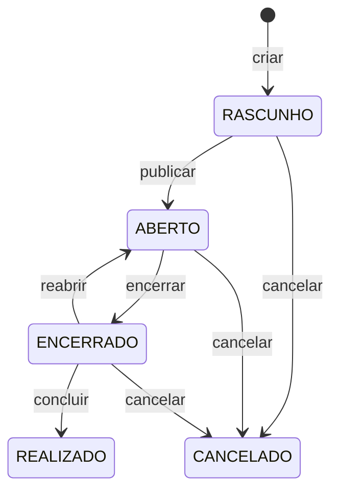

# Desafio Sulwork: organização de eventos de alimentação

Aplicação para organizar eventos de alimentação, como cafés da manhã, almoços e confraternizações da empresa, ou uma ceia em família. Os participantes combinam **o que cada um vai levar** e acompanham **o que ainda falta**.

Repositório: [github.com/IasminBorba/desafio-sulwork](https://github.com/IasminBorba/desafio-sulwork)

## O problema

Em todo evento em que cada um leva alguma coisa, as mesmas perguntas aparecem:
- Quem vai levar o quê?
- Quanto já está garantido?
- Vai sobrar refrigerante e faltar sobremesa?
- Tem alguma opção para quem é celíaco, intolerante à lactose ou vegano?

Sem uma lista compartilhada, a combinação fica espalhada em mensagens, e o organizador só descobre o que faltou no dia.

## A solução

- O **organizador** cria o evento, define os itens necessários por categoria (com quantidade, obrigatoriedade e alérgenos), as metas por categoria e um **prazo** para as combinações.
- Os **participantes** entram no evento e registram o que vão levar. Várias pessoas podem dividir um item, mas a soma nunca passa do necessário.
- O sistema mostra em tempo real a **cobertura** do evento (quanto das necessidades já foi atendido) e os **conflitos entre as restrições alimentares dos participantes e os alérgenos dos itens**.
- O organizador tem um **painel** com os detalhes do evento, os percentuais e **o que cada participante vai levar**.
- Depois do prazo, ou com o evento encerrado, nenhuma alteração é aceita.

## Funcionalidades

- **Contas de colaborador e permissões por evento** (funcionalidade livre):
  - cadastro com CPF validado e login;
  - quem cria o evento é o organizador dele;
  - cada pessoa gerencia apenas as próprias participações e contribuições.
- **Eventos com ciclo de vida:** `RASCUNHO` → `ABERTO` → `ENCERRADO` → `REALIZADO`, além de `CANCELADO`. As ações permitidas dependem do status, e o encerramento acontece automaticamente quando o prazo vence.
- **Itens e metas por categoria**, com itens obrigatórios ou opcionais e seus alérgenos.
- **Contribuições** com limite pela quantidade necessária e controle de concorrência.
- **Cobertura do evento:** percentual geral, por categoria e por item, e lista dos obrigatórios pendentes.
- **Restrições alimentares x alérgenos:** itens que não atendem algum participante e restrições sem nenhum item compatível.
- **Painel do organizador:** visão consolidada do evento e das contribuições por participante.

## Aplicação publicada

| Peça | URL |
|---|---|
| Frontend | https://desafio-sulwork-omega.vercel.app |
| API | https://desafio-sulwork.onrender.com/api/v1 |
| Swagger | https://desafio-sulwork.onrender.com/docs |

No plano gratuito o backend no Render dorme depois de alguns minutos sem acesso. A primeira chamada pode levar cerca de um minuto.

### Contas de demonstração

A migration `V3` cria três contas com a senha `senha123`:

| Nome | E-mail | Papel no exemplo |
|---|---|---|
| Ana Souza | ana.souza@sulwork.demo | organiza o churrasco aberto e um rascunho |
| Bia Lima | bia.lima@sulwork.demo | participa do churrasco (celíaca) |
| Carlos Dias | carlos.dias@sulwork.demo | organiza um almoço já encerrado (vegano) |

No Swagger, use `POST /api/v1/auth/login`, copie o `token` da resposta e clique em **Authorize**. Cole só o token (sem a palavra `Bearer`).

## Tecnologias

| Camada | Tecnologia | Versão |
|---|---|---|
| Backend | Java (Temurin), Spring Boot (Web MVC, Data JPA, Security JWT, Validation, Actuator) | Java 21, Boot 4.1.1 |
| Banco | PostgreSQL + Flyway | 17 |
| API docs | springdoc-openapi | 3.1.1 |
| Testes (back) | JUnit 5, Mockito, MockMvc, Testcontainers, JaCoCo | — |
| Frontend | React, Vite, TypeScript, React Router | React 19, Vite 8 |
| Testes (front) | Vitest, Testing Library, jsdom | — |
| Infra | Docker e Docker Compose | — |

## Arquitetura

Monorepo com API REST em `backend/`, SPA em `frontend/` e `docker-compose.yml` para subir os três serviços.

O backend é organizado **por funcionalidade** (`auth`, `evento`, `item`, `meta`, `participacao`, `contribuicao`, `cobertura`, `restricao`, `painel`). Cada pacote reúne controller, service, repository, entidade e DTOs, no estilo de uma “app” do Django. O domínio fica em português (`Evento`, `Participacao`); os sufixos técnicos em inglês (`Controller`, `Service`).

Padrões usados:

| Padrão | Onde |
|---|---|
| Service Layer + Repository | controller → service → repository |
| DTO + Mapper | `record` na API; entidades nunca saem na resposta |
| State | `StatusEvento` e os métodos `publicar()`, `encerrar()`, `reabrir()`, `concluir()`, `cancelar()` |
| Strategy | `CalculadoraCobertura` |
| Auditoria | `EntidadeAuditavel` (`criado_em` / `atualizado_em`) nas entidades de negócio |
| Exception handler | `ProblemDetail` (RFC 9457) |

Consultas **SQL nativas** calculam a cobertura e encerram automaticamente os eventos com prazo vencido (`EncerramentoPorPrazoService`). JPA com `open-in-view: false` e `ddl-auto: validate`; o schema vem só do Flyway.

O frontend é uma SPA (React + Vite). Em produção na Vercel ela chama a API no Render. No Docker Compose, o nginx do front encaminha `/api` para o backend, então o browser usa a mesma origem.

## Como executar

Requisitos: Docker (para o compose ou só o banco), Java 21 e Node 22 se for rodar fora do container.

Copie `.env.example` para `.env` se quiser mudar usuário, senha ou JWT. **Não commite o `.env`.**

### Com Docker (frontend, backend e banco)

Na raiz do repositório:

```bash
docker compose up --build
```

| Serviço | URL |
|---|---|
| Frontend | http://localhost |
| API | http://localhost:8080/api/v1 |
| Swagger | http://localhost:8080/docs |
| Postgres | localhost:5433 |

O primeiro `--build` baixa imagens e compila Maven + npm; demora vários minutos. Para encerrar: `docker compose down`. O volume do banco persiste; `docker compose down -v` apaga os dados.

### Sem Docker (API e front na máquina, banco no Compose)

1. Suba só o Postgres:

```bash
docker compose up -d db
```

2. Backend, na pasta `backend/` (Java 21 no `JAVA_HOME`):

```bash
./mvnw spring-boot:run
```

No Windows: `.\mvnw.cmd spring-boot:run`. A API usa `jdbc:postgresql://localhost:5433/eventos` (usuário/senha `eventos`).

3. Frontend, na pasta `frontend/`:

```bash
npm install
npm run dev
```

O Vite sobe em http://localhost:5173 e chama `http://localhost:8080/api/v1`.

## Testes

Backend (unitários e de integração com Testcontainers; precisa de Docker):

```bash
cd backend
./mvnw test
```

O Surefire inclui `*Test`, `*Tests` e `*IT`. No GitHub Actions de 21/10/2026 passaram **155 testes** do backend; o JaCoCo analisou **92 classes**. O percentual (instruções, ramos e linhas) fica no HTML gerado na mesma execução, em `backend/target/site/jacoco/index.html`.

Frontend:

```bash
cd frontend
npm test
```

No mesmo CI passaram **17 testes** em 8 arquivos (Vitest + Testing Library).

## Regras: status, permissões e prazo



| Status | Significado | Aceita contribuições? |
|---|---|---|
| `RASCUNHO` | Organizador ainda monta itens e metas. Invisível para os demais. | Não |
| `ABERTO` | Publicado; participantes entram e contribuem. | Sim, até o prazo |
| `ENCERRADO` | Combinações fechadas; o evento ainda não aconteceu. | Não |
| `REALIZADO` | O evento já aconteceu. Estado final. | Não |
| `CANCELADO` | Cancelado. Estado final. | Não |

Publicar exige prazo no futuro e pelo menos um item. Concluir só depois da data de início. Reabrir (só a partir de `ENCERRADO`) exige um novo prazo que não esteja no passado; se a data de início já passou, também é obrigatório remarcar início e fim.

| Ação | RASCUNHO | ABERTO | ENCERRADO | REALIZADO / CANCELADO |
|---|---|---|---|---|
| Ver (quem não organiza) | não (404) | sim | sim | sim |
| Editar evento, itens e metas | organizador | organizador | não | não |
| Excluir evento | organizador | não | não | não |
| Transições de status | organizador | organizador | organizador | — |
| Participar / contribuir | não | até o prazo | não | não |
| Painel do organizador | organizador | organizador | organizador | organizador |

O **prazo é a regra de verdade**. Mesmo que o status ainda esteja `ABERTO`, participação e contribuição são recusadas depois do prazo. Na próxima consulta, um `UPDATE` nativo alinha o status para `ENCERRADO` (encerramento *lazy*, sem agendador). O relógio vem do `Clock` da aplicação, fuso America/Recife; no instante exato do prazo o evento ainda aceita alteração.

## Cálculo da cobertura

Os totais contribuídos, o faltante e os percentuais **não são gravados**: saem de uma consulta SQL nativa + a estratégia `CalculadoraCobertura`.

```
cobertura_item         = min(contribuído, necessária) / necessária
A = média ponderada de cobertura_item (obrigatório peso 2, opcional peso 1)
B = média de min(contribuído na categoria, meta) / meta   (só categorias com meta)
C = obrigatórios 100% atendidos / total de obrigatórios

cobertura_geral = 0,5·A + 0,3·B + 0,2·C
```

Casos-limite: sem metas → `(0,5·A + 0,2·C) / 0,7`; sem obrigatórios → `(0,5·A + 0,3·B) / 0,8`; sem os dois → `A`; evento sem itens → `0%`.

Além do percentual, a API devolve A, B e C, a cobertura por categoria e por item, e a **lista de obrigatórios ainda sem cobertura completa**.

**Exemplo:** refrigerante 2 L (obrigatório, 5/10), bolo (obrigatório, 2/2) e guardanapo (opcional, 0/100). Metas: bebidas 12, doces 2.

| Componente | Conta | Valor |
|---|---|---|
| A | `(2·0,50 + 2·1,00 + 1·0) / 5` | 0,60 |
| B | `(5/12 + 2/2) / 2` | 0,708 |
| C | 1 de 2 obrigatórios completos | 0,50 |
| Geral | `0,5·0,60 + 0,3·0,708 + 0,2·0,50` | **61%** |

O refrigerante entra na lista de obrigatórios pendentes.

## Restrições alimentares e alérgenos

Catálogos fixos (seed), sem cadastro pelo usuário. A tabela `RestricaoAlergeno` coloca restrições e alérgenos no mesmo vocabulário, então o sistema avisa qual item não serve para N participantes e quais restrições ficaram sem nenhum item compatível.

A lista de alérgenos parte da rotulagem obrigatória da **RDC 26/2015 (Anvisa)**, mais `Carne` e `Mel` para vegetariano e vegano. A tabela continua se chamando `Alergeno`, com a premissa de que o catálogo representa “alérgenos e componentes” a evitar.

**Alérgenos:** Glúten, Leite e derivados, Ovo, Amendoim, Castanhas e nozes, Soja, Peixe, Crustáceos, Gergelim, Carne, Mel.

| Restrição | Evita |
|---|---|
| Doença celíaca / sem glúten | Glúten |
| Intolerância à lactose / alergia a leite | Leite e derivados |
| Alergia a ovo, amendoim, castanhas, soja, peixe, crustáceos ou gergelim | o alérgeno correspondente |
| Vegetariano | Carne, Peixe, Crustáceos |
| Vegano | Carne, Peixe, Crustáceos, Leite e derivados, Ovo, Mel |

O aviso no formulário de contribuição **não bloqueia**: quem é celíaco ainda pode se comprometer a levar pão, se quiser.

## Feature livre: contas de colaborador e permissões por evento

O enunciado não exige autenticação. A funcionalidade adicional é o **controle de quem pode ver e alterar cada evento**.

**Problema.** Sem identificação, qualquer pessoa poderia editar ou cancelar o evento de outra, mudar a contribuição de um colega (ou contribuir em nome dele) e ver eventos ainda em montagem. Numa lista compartilhada do que falta, isso quebra a confiança.

**Como funciona.**

- Cadastro com CPF validado (Módulo 11, rejeita sequência de dígitos iguais) e senha com BCrypt; login com JWT.
- Quem cria o evento é o **organizador daquele evento**. Não é um tipo de usuário: a mesma pessoa organiza um e participa de outro.
- Só o organizador edita o evento, os itens e as metas e muda o status.
- Cada pessoa gerencia só as próprias participações e contribuições.
- `RASCUNHO` é invisível para os demais (a API responde 404, não 403, para não revelar que o evento existe).
- As restrições alimentares vêm do perfil logado.

**Decisões.** Pessoa e Usuário são a mesma entidade. JWT sem sessão, porque o backend no Render não guarda estado. CPF mascarado nas respostas. Sugestões personalizadas de contribuição ficaram de fora de propósito: a IA as sugeriu como feature livre; o login resolve um problema mais grave.

## Decisões, premissas e ambiguidades

O desafio deixa várias regras abertas. Resumo do que foi escolhido (detalhe e origem em [`docs/DECISOES.md`](docs/DECISOES.md)):

- **Prazo × status:** o prazo manda; o status é alinhado na leitura (encerramento lazy).
- **Organizador** é papel no evento, não perfil global.
- **Participação sem status:** participar cria o registro, cancelar apaga; não há histórico de quem saiu.
- **`TipoEvento` como enum**, não tabela.
- **Meta por categoria** é um valor independente, não a soma dos itens.
- **Cobertura** com a fórmula e os casos-limite acima.
- **Vegano/vegetariano** no mesmo cruzamento de alérgenos, sem renomear a tabela.
- **Contribuição** com lock pessimista no item, para a soma não passar do necessário sob concorrência.

## Uso de IA

IA foi usada como apoio. As decisões finais, a revisão e a responsabilidade pelo código são minhas. O relato completo está em [`docs/USO-DE-IA.md`](docs/USO-DE-IA.md).

## Documentação

| Documento | Conteúdo |
|---|---|
| [Decisões de modelagem](docs/DECISOES.md) | Decisões sobre as regras abertas do desafio, com a origem de cada uma |
| [Regras de negócio](docs/REGRAS-DE-NEGOCIO.md) | Regras numeradas (`RN-xx`), origem e respostas da API |
| [Casos de uso](docs/CASOS-DE-USO.md) | Atores, fluxos principais, alternativos e exceções |
| [Uso de IA](docs/USO-DE-IA.md) | Ferramentas, etapas, sugestões aceitas e alteradas, julgamento próprio |
| [Diagrama ER](docs/diagrama.jpg) | Modelo de dados |
