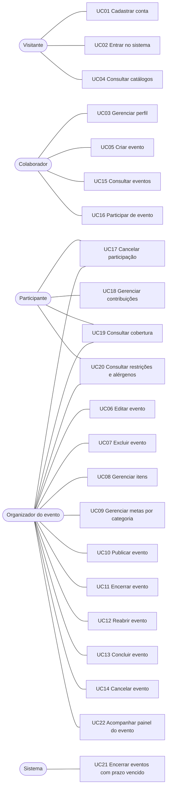

# Casos de uso

Este documento descreve os casos de uso do sistema de eventos de alimentação da Sulwork. As regras citadas (`RN-xx`) estão em [`REGRAS-DE-NEGOCIO.md`](REGRAS-DE-NEGOCIO.md), e as decisões que as originaram, em [`DECISOES.md`](DECISOES.md).

---

## 1. Atores

| Ator | Quem é |
|---|---|
| **Visitante** | Pessoa sem login. Só pode se cadastrar, entrar e consultar os catálogos. |
| **Colaborador** | Usuário logado. Pode criar eventos, ver eventos publicados e participar deles. |
| **Participante** | Colaborador que participa de um evento. Gerencia as próprias contribuições naquele evento. |
| **Organizador do evento** | Colaborador que criou o evento. É um **papel por evento**, não um tipo de usuário (RN-09). |
| **Sistema** | Executa o encerramento automático por prazo (RN-25). |

Um colaborador pode ser organizador de um evento e participante de outro, ou dos dois papéis no mesmo evento (RN-12).

## 2. Visão geral

| ID | Caso de uso | Ator principal |
|---|---|---|
| UC01 | Cadastrar conta | Visitante |
| UC02 | Entrar no sistema | Visitante |
| UC03 | Gerenciar perfil | Colaborador |
| UC04 | Consultar catálogos | Visitante / Colaborador |
| UC05 | Criar evento | Colaborador |
| UC06 | Editar evento | Organizador |
| UC07 | Excluir evento | Organizador |
| UC08 | Gerenciar itens do evento | Organizador |
| UC09 | Gerenciar metas por categoria | Organizador |
| UC10 | Publicar evento | Organizador |
| UC11 | Encerrar evento | Organizador |
| UC12 | Reabrir evento | Organizador |
| UC13 | Concluir evento | Organizador |
| UC14 | Cancelar evento | Organizador |
| UC15 | Consultar eventos | Colaborador |
| UC16 | Participar de evento | Colaborador |
| UC17 | Cancelar participação | Participante / Organizador |
| UC18 | Gerenciar contribuições | Participante |
| UC19 | Consultar cobertura do evento | Colaborador |
| UC20 | Consultar restrições e alérgenos do evento | Colaborador |
| UC21 | Encerrar eventos com prazo vencido | Sistema |
| UC22 | Acompanhar painel do evento (o que cada participante vai levar) | Organizador |
| UC23 | Consultar sugestões de contribuição *(extra, se houver tempo)* | Participante |

---

## 3. Conta e acesso

### UC01: Cadastrar conta
- **Ator:** Visitante.
- **Objetivo:** criar uma conta de colaborador.
- **Pré-condições:** nenhuma.
- **Fluxo principal:**
  1. O visitante informa nome, CPF, e-mail e senha.
  2. O visitante seleciona as suas restrições alimentares no catálogo (opcional).
  3. O sistema valida os dados e cria a conta.
  4. O sistema confirma o cadastro.
- **Exceções:**
  - E1. CPF inválido: o sistema recusa e indica o campo (RN-02).
  - E2. CPF ou e-mail já cadastrado: o sistema recusa e informa a duplicidade (RN-03).
  - E3. Senha com menos de 8 caracteres: o sistema recusa (RN-04).
- **Pós-condição:** conta criada, com a senha armazenada apenas como hash.
- **Regras:** RN-01 a RN-05.

### UC02: Entrar no sistema
- **Ator:** Visitante.
- **Objetivo:** autenticar-se para usar o sistema.
- **Pré-condições:** possuir conta.
- **Fluxo principal:**
  1. O visitante informa e-mail e senha.
  2. O sistema valida as credenciais.
  3. O sistema libera o acesso por um tempo limitado.
- **Exceções:**
  - E1. Credenciais inválidas: o sistema recusa, sem indicar qual dos dois campos está errado.
  - E2. Sessão expirada em uso posterior: o sistema pede um novo login.
- **Pós-condição:** colaborador autenticado.
- **Regras:** RN-08.

### UC03: Gerenciar perfil
- **Ator:** Colaborador.
- **Objetivo:** ver e atualizar os próprios dados.
- **Pré-condições:** estar logado.
- **Fluxo principal:**
  1. O colaborador abre o perfil.
  2. O sistema mostra nome, CPF, e-mail e restrições alimentares.
  3. O colaborador altera o nome e/ou as restrições.
  4. O sistema salva as alterações.
- **Exceções:**
  - E1. Tentativa de alterar CPF ou e-mail: não permitido (RN-06).
- **Pós-condição:** perfil atualizado. As novas restrições passam a valer nos cruzamentos de todos os eventos em que a pessoa participa.
- **Regras:** RN-06, RN-50, RN-51.

### UC04: Consultar catálogos
- **Ator:** Visitante ou Colaborador.
- **Objetivo:** consultar as categorias, os alérgenos e as restrições alimentares disponíveis.
- **Fluxo principal:**
  1. O ator solicita um catálogo.
  2. O sistema lista os valores. No caso das restrições, mostra também os alérgenos ligados a cada uma.
- **Regras:** RN-28, RN-50 a RN-52.

---

## 4. Organização do evento

### UC05: Criar evento
- **Ator:** Colaborador.
- **Objetivo:** criar um novo evento de alimentação.
- **Pré-condições:** estar logado.
- **Fluxo principal:**
  1. O colaborador informa nome, descrição, tipo, data de início, data de fim e prazo para alterações.
  2. O sistema valida os dados.
  3. O sistema cria o evento em `RASCUNHO`, com o colaborador como organizador.
- **Exceções:**
  - E1. Campo obrigatório ausente ou tipo inválido: o sistema recusa (RN-13, RN-14).
  - E2. Prazo depois da data de início, ou data de fim antes da data de início: o sistema recusa (RN-15).
- **Pós-condição:** evento em `RASCUNHO`, visível só para o organizador.
- **Regras:** RN-13 a RN-17.

### UC06: Editar evento
- **Ator:** Organizador.
- **Objetivo:** alterar os dados do evento.
- **Pré-condições:** ser o organizador; evento em `RASCUNHO` ou `ABERTO`.
- **Fluxo principal:**
  1. O organizador altera os dados desejados.
  2. O sistema valida as datas.
  3. O sistema salva as alterações.
- **Exceções:**
  - E1. Quem tenta editar não é o organizador: acesso negado (RN-10).
  - E2. Evento em outro status: o sistema recusa (RN-18).
  - E3. Datas inválidas: o sistema recusa (RN-15).
- **Observação:** se o prazo for alterado para um momento já passado em um evento `ABERTO`, o evento será encerrado automaticamente na próxima consulta (UC21).
- **Regras:** RN-10, RN-15, RN-18.

### UC07: Excluir evento
- **Ator:** Organizador.
- **Pré-condições:** ser o organizador; evento em `RASCUNHO`.
- **Fluxo principal:**
  1. O organizador solicita a exclusão.
  2. O sistema pede confirmação.
  3. O sistema exclui o evento, com seus itens e metas.
- **Exceções:**
  - E1. Evento fora de `RASCUNHO`: o sistema recusa e sugere cancelar o evento (UC14).
- **Regras:** RN-10, RN-18.

### UC08: Gerenciar itens do evento
- **Ator:** Organizador.
- **Objetivo:** definir o que o evento precisa.
- **Pré-condições:** ser o organizador; evento em `RASCUNHO` ou `ABERTO` (o prazo não bloqueia o organizador).
- **Fluxo principal: incluir item**
  1. O organizador informa nome, categoria, quantidade necessária, se é obrigatório ou opcional e os alérgenos.
  2. O sistema valida e salva o item.
- **Fluxo alternativo A1: alterar item**
  1. O organizador altera os dados do item.
  2. O sistema valida e salva.
- **Fluxo alternativo A2: excluir item**
  1. O organizador solicita a exclusão.
  2. O sistema verifica os bloqueios e exclui o item.
- **Exceções:**
  - E1. Quantidade não é um inteiro maior que zero: o sistema recusa (RN-30).
  - E2. Nova quantidade menor que o total já contribuído: o sistema recusa e informa o total atual (RN-32).
  - E3. Exclusão de item com contribuições: o sistema recusa (RN-33).
  - E4. Exclusão do último item de uma categoria com meta, ou mudança de categoria desse item: o sistema recusa e explica que a meta precisa ser removida antes (RN-34).
  - E5. Evento fora de `RASCUNHO` ou `ABERTO`: o sistema recusa (RN-31).
- **Regras:** RN-29 a RN-34.

### UC09: Gerenciar metas por categoria
- **Ator:** Organizador.
- **Objetivo:** definir uma quantidade mínima de unidades contribuídas por categoria.
- **Pré-condições:** ser o organizador; evento em `RASCUNHO` ou `ABERTO`.
- **Fluxo principal: criar meta**
  1. O organizador escolhe a categoria e informa a quantidade da meta.
  2. O sistema verifica se já existe item dessa categoria no evento.
  3. O sistema salva a meta.
- **Fluxos alternativos:**
  - A1. Alterar a quantidade da meta.
  - A2. Excluir a meta. Depois disso, o último item da categoria volta a poder ser excluído.
- **Exceções:**
  - E1. Não há item da categoria no evento: o sistema recusa (RN-36).
  - E2. Já existe meta para a categoria nesse evento: o sistema recusa e sugere alterar a existente (RN-35).
  - E3. Quantidade não é um inteiro maior que zero: o sistema recusa (RN-35).
- **Regras:** RN-35 a RN-38.

### UC10: Publicar evento
- **Ator:** Organizador.
- **Pré-condições:** evento em `RASCUNHO`.
- **Fluxo principal:**
  1. O organizador solicita a publicação.
  2. O sistema verifica se o prazo está no futuro e se há pelo menos um item.
  3. O evento passa para `ABERTO` e fica visível aos colaboradores.
- **Exceções:**
  - E1. Prazo já vencido ou nenhum item cadastrado: o sistema recusa e informa o motivo (RN-20).
- **Regras:** RN-19, RN-20.

### UC11: Encerrar evento
- **Ator:** Organizador.
- **Pré-condições:** evento `ABERTO`.
- **Fluxo principal:**
  1. O organizador encerra o evento antes do prazo.
  2. O evento passa para `ENCERRADO`, e nenhuma participação ou contribuição é mais aceita.
- **Observação:** o encerramento também acontece automaticamente quando o prazo vence (UC21).
- **Regras:** RN-19, RN-23.

### UC12: Reabrir evento
- **Ator:** Organizador.
- **Objetivo:** voltar a aceitar participações e contribuições.
- **Pré-condições:** evento `ENCERRADO`.
- **Fluxo principal:**
  1. O organizador informa o novo prazo para alterações.
  2. O sistema verifica que o novo prazo não é anterior ao momento atual.
  3. O sistema verifica que a data de início do evento ainda não passou.
  4. O sistema atualiza o prazo, e o evento volta para `ABERTO`.
- **Fluxo alternativo A1: a data de início já passou (evento remarcado)**
  1. No passo 3, o sistema identifica que a data de início já passou e exige novas datas de início e de fim.
  2. O organizador informa as novas datas.
  3. O sistema valida as datas (a nova data de início não pode ser anterior ao momento atual; RN-15).
  4. O sistema atualiza o prazo e as datas, e o evento volta para `ABERTO`.
- **Exceções:**
  - E1. Novo prazo ausente ou anterior ao momento atual: o sistema recusa (RN-22a).
  - E2. Data de início já passou e as novas datas não foram informadas: o sistema recusa com a mensagem "o evento já passou da data de início; informe novas datas" (RN-22b).
  - E3. Prazo depois da data de início, ou data de fim antes da data de início: o sistema recusa (RN-15).
  - E4. Evento não está `ENCERRADO`: o sistema recusa (RN-19).
- **Regras:** RN-15, RN-19, RN-22.

### UC13: Concluir evento
- **Ator:** Organizador.
- **Pré-condições:** evento `ENCERRADO`.
- **Fluxo principal:**
  1. O organizador marca o evento como realizado.
  2. O sistema verifica se a data de início já passou.
  3. O evento passa para `REALIZADO` (estado final).
- **Exceções:**
  - E1. A data de início ainda não chegou: o sistema recusa (RN-21).
- **Regras:** RN-19, RN-21.

### UC14: Cancelar evento
- **Ator:** Organizador.
- **Pré-condições:** evento em `RASCUNHO`, `ABERTO` ou `ENCERRADO`.
- **Fluxo principal:**
  1. O organizador solicita o cancelamento.
  2. O sistema pede confirmação.
  3. O evento passa para `CANCELADO` (estado final). Participações e contribuições ficam apenas para consulta.
- **Exceções:**
  - E1. Evento já `REALIZADO` ou `CANCELADO`: o sistema recusa (RN-19).
- **Regras:** RN-19.

### UC22: Acompanhar painel do evento
- **Ator:** Organizador.
- **Objetivo:** ver, em uma única tela, o que cada participante vai levar, quanto do evento já está garantido e o que ainda falta.
- **Pré-condições:** ser o organizador do evento (em qualquer status).
- **Fluxo principal:**
  1. O organizador abre o painel do evento.
  2. O sistema aplica o encerramento automático por prazo (UC21) e mostra, na mesma tela:
     - **Detalhes do evento:** nome, tipo, status, datas, prazo para alterações, se ainda aceita alterações e quanto tempo falta para o prazo.
     - **Percentuais:** cobertura geral e os seus três componentes (itens, metas, obrigatórios); cobertura de cada categoria com meta; percentual de cada item.
     - **Contribuições por participante:** para cada participante, as restrições alimentares e a lista do que vai levar (item, categoria, quantidade). Cada participante aparece uma única vez, com as contribuições agrupadas.
     - **Participantes sem contribuição**, destacados ("ainda não definiu o que vai levar").
     - **Pendências:** itens obrigatórios ainda sem cobertura completa e o faltante de cada item.
     - **Alertas de restrição:** itens que não atendem algum participante e restrições sem nenhum item compatível.
- **Fluxos alternativos:**
  - A1. O organizador alterna a lista de contribuições entre "por participante" e "por item" (para cada item, quem vai levar e quanto).
  - A2. A partir do painel, o organizador acessa as ações de gerenciamento já existentes: itens (UC08), metas (UC09), status (UC10 a UC14) e cancelamento de participação (UC17).
- **Exceções:**
  - E1. Quem acessa não é o organizador: acesso negado (RN-61).
  - E2. Evento sem itens ou sem participantes: o painel mostra os detalhes do evento, cobertura 0% e uma orientação do próximo passo ("cadastre itens" / "publique o evento para receber participantes").
- **Pós-condição:** nenhuma alteração de dados; a tela só consulta.
- **Regras:** RN-17, RN-54, RN-56 a RN-59, RN-61, RN-62.

---

## 5. Participação

### UC15: Consultar eventos
- **Ator:** Colaborador.
- **Objetivo:** encontrar eventos e acompanhar os seus.
- **Fluxo principal:**
  1. O colaborador abre a lista de eventos.
  2. O sistema lista os eventos visíveis, com filtros por status e por papel ("organizo" / "participo").
  3. O colaborador abre um evento e vê os dados, os itens com o faltante de cada um, as metas, os participantes e se o evento ainda aceita alterações.
- **Regras de visibilidade:**
  - eventos em `RASCUNHO` aparecem só para o organizador;
  - para os demais, um rascunho é tratado como inexistente (RN-17).
- **Observação:** antes de listar, o sistema aplica o encerramento automático (UC21), para os status mostrados estarem corretos.
- **Regras:** RN-17, RN-25, RN-43.

### UC16: Participar de evento
- **Ator:** Colaborador.
- **Pré-condições:** evento `ABERTO` e dentro do prazo.
- **Fluxo principal:**
  1. O colaborador solicita a participação.
  2. O sistema verifica o status, o prazo e se a pessoa já participa.
  3. O sistema registra a participação.
- **Exceções:**
  - E1. Já participa do evento: o sistema recusa (RN-39).
  - E2. Evento fora de `ABERTO` ou prazo vencido: o sistema recusa (RN-23).
- **Pós-condição:** a pessoa passa a ser participante, e as restrições dela entram nos cruzamentos do evento.
- **Regras:** RN-12, RN-23, RN-39, RN-40.

### UC17: Cancelar participação
- **Ator:** Participante (a própria participação) ou Organizador (qualquer participação do evento).
- **Pré-condições:** evento `ABERTO` e dentro do prazo.
- **Fluxo principal:**
  1. O ator solicita o cancelamento.
  2. O sistema avisa que as contribuições da pessoa também serão removidas e pede confirmação.
  3. O sistema remove a participação e as contribuições dela.
- **Exceções:**
  - E1. O ator não é o dono da participação nem o organizador: acesso negado (RN-11).
  - E2. Prazo vencido ou evento fora de `ABERTO`: o sistema recusa (RN-23).
- **Pós-condição:** os itens que essa pessoa cobria voltam a aparecer como faltantes.
- **Regras:** RN-11, RN-23, RN-41, RN-42.

### UC18: Gerenciar contribuições
- **Ator:** Participante.
- **Objetivo:** combinar o que vai levar.
- **Pré-condições:** participar do evento; evento `ABERTO` e dentro do prazo.
- **Fluxo principal: incluir contribuição**
  1. O participante escolhe um item e informa a quantidade.
  2. Se o item conflita com a restrição de algum participante, o sistema mostra um aviso, sem bloquear (RN-55).
  3. O sistema verifica se a soma das contribuições não ultrapassa a quantidade necessária.
  4. O sistema registra a contribuição e atualiza o faltante e a cobertura.
- **Fluxo alternativo A1: alterar quantidade**
  1. O participante altera a quantidade de uma contribuição sua.
  2. O sistema refaz a verificação do limite, sem contar a quantidade anterior dessa contribuição.
  3. O sistema salva.
- **Fluxo alternativo A2: remover contribuição**
  1. O participante remove uma contribuição sua.
  2. O item volta a ter esse valor como faltante.
- **Exceções:**
  - E1. Soma acima do necessário: o sistema recusa e informa quanto ainda falta (RN-47).
  - E2. Já existe contribuição dessa pessoa para o item: o sistema orienta a alterar a existente (RN-46).
  - E3. Não participa do evento, ou o item é de outro evento: o sistema recusa (RN-45).
  - E4. Prazo vencido ou evento fora de `ABERTO`: o sistema recusa (RN-23, RN-48).
  - E5. Tentativa de alterar ou remover a contribuição de outra pessoa: acesso negado (RN-49).
  - E6. Quantidade não é um inteiro maior que zero: o sistema recusa (RN-44).
- **Regras:** RN-23, RN-44 a RN-49, RN-55.

### UC19: Consultar cobertura do evento
- **Ator:** Colaborador que pode ver o evento.
- **Objetivo:** saber quanto das necessidades do evento já foi atendido.
- **Fluxo principal:**
  1. O ator abre a cobertura do evento.
  2. O sistema calcula e mostra:
     - a cobertura geral e os seus três componentes (itens, metas, obrigatórios);
     - a cobertura por categoria com meta;
     - por item: necessário, contribuído e faltante;
     - a **lista de obrigatórios ainda sem cobertura completa**.
- **Regras:** RN-56 a RN-59.

### UC20: Consultar restrições e alérgenos do evento
- **Ator:** Colaborador que pode ver o evento.
- **Objetivo:** saber se o que está sendo levado atende a todos.
- **Fluxo principal:**
  1. O ator abre a análise de restrições do evento.
  2. O sistema mostra:
     - quantos participantes têm cada restrição;
     - para cada item, quais participantes ele não atende;
     - as restrições que não têm nenhum item compatível.
- **Regras:** RN-51 a RN-54.

---

## 6. Sistema

### UC21: Encerrar eventos com prazo vencido
- **Ator:** Sistema.
- **Gatilho:** qualquer consulta ou alteração envolvendo eventos (listagem, detalhe, cobertura, restrições, participações, contribuições).
- **Fluxo principal:**
  1. Antes de atender a solicitação, o sistema muda para `ENCERRADO` todos os eventos `ABERTO` cujo prazo já passou.
  2. O sistema segue com a solicitação original, já com os status atualizados.
- **Regras importantes:**
  - no instante exato do prazo, o evento continua `ABERTO` (RN-25);
  - mesmo que esta etapa não tenha rodado, nenhuma alteração é aceita depois do prazo (RN-24).
- **Regras:** RN-23 a RN-25, RN-27.

---

## 7. Extra (se houver tempo)

### UC23: Consultar sugestões de contribuição
- **Ator:** Participante.
- **Objetivo:** saber o que é mais útil levar.
- **Fluxo principal:**
  1. O participante abre as sugestões do evento.
  2. O sistema lista os itens que ainda têm faltante, nesta ordem: obrigatórios primeiro, depois os com maior percentual faltante.
  3. O sistema marca os itens que conflitam com as restrições do próprio participante.
- **Regras:** RN-53, RN-56.
